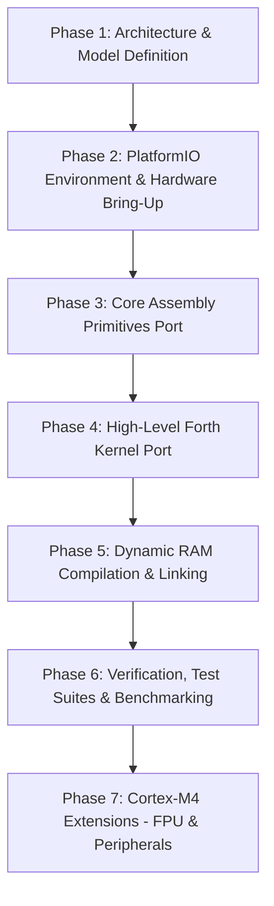

# Implementation Plan: Direct-Threaded Forth Kernel for ARM Cortex-M4 (STM32G474)

Implement and validate a direct-threaded Forth kernel for the ARM Cortex-M4 (ARMv7E-M / Thumb-2), based on Brad Rodriguez's CamelForth model and the 32-bit Z382 CamelForth port (`CAML382d.S`, `CAML382.s`, `CAML382h.S`). The core Forth kernel will execute from ROM (Flash memory at `0x08000000`), while dynamically defined words and variables will compile into and execute from RAM (`0x20000000`). The target MCU platform for hardware validation is the STM32G474 (Nucleo-G474RE) using PlatformIO.

---

## User Review Required

> [!IMPORTANT]
> **Key Architectural Decisions for Review:**
> 1. **DTC and Thumb-2 Branch Range Across ROM/RAM:** 
>    Flash is located at `0x08000000` and SRAM is located at `0x20000000` (a 384 MB separation). The ARM Thumb-2 `BL` instruction has an immediate range of $\pm 16\text{ MB}$. To maintain an identical 4-byte Code Field (`BL <target>`) and uniform `>BODY` (`3 +`) across both ROM and RAM, we propose placing a compact 40-byte **RAM Trampoline Table** at the start of SRAM (`ram_docolon`, `ram_docon`, `ram_dovar`, `ram_douser`, `ram_dodoes`). RAM-compiled words execute `BL ram_docolon` (distance $< 128\text{ KB}$), which performs an indirect jump to `docolon` in Flash while preserving `LR` (the Parameter Field Address).
> 2. **Forth VM Register Allocation:**
>    To maximize code density and leverage fast 16-bit Thumb instructions, all primary Forth VM registers are allocated to ARM low registers (`R0`–`R7`):
>    - `R0`: `TOS` (Top of Stack)
>    - `R1`: `W` (Working Register / CFA)
>    - `R2` / `R3`: Temporaries / scratch (`T1`, `T2`)
>    - `R4`: `IP` (Interpreter Pointer)
>    - `R5`: `PSP` (Parameter Stack Pointer, grows downward)
>    - `R6`: `RSP` (Return Stack Pointer, grows downward)
>    - `R7`: `UP` (User Area Pointer)
>    - Hardware `SP` (`R13`) remains dedicated to Cortex-M exception / C runtime stack.
> 3. **Startup Harness:**
>    PlatformIO project will initially boot via a minimal C `main.c` harness that initializes system clocks (170 MHz) and LPUART1 on `PA2`/`PA3` (115200 baud), then transfers control to Forth `COLD`. A pure assembly boot option can be enabled once the kernel is validated.

---

## Proposed Memory Map

### STM32G474 Memory Layout

```
+-------------------------------------------------------------+
| Flash Memory (512 KB, 0x08000000 - 0x0807FFFF)              |
+-------------------------------------------------------------+
| 0x08000000: ARM Vector Table & C Startup / Reset Handler     |
| 0x08000400: Forth ROM Kernel Primitives (Code Words)        |
|            - Inner Interpreter (NEXT, docolon, dovar, etc.) |
|            - Assembly Primitives (DUP, +, @, CMOVE, etc.)   |
|            - Architecture Dependencies (ALIGN, !CF, ,CF)    |
|            - High-Level Forth Kernel (WORD, FIND, QUIT...)  |
|            - ROM Dictionary Tail (ROM_LATEST)               |
|            - Initial User Data Image (UINIT, #INIT)         |
+-------------------------------------------------------------+

+-------------------------------------------------------------+
| SRAM1 (80 KB, 0x20000000 - 0x20013FFF)                      |
+-------------------------------------------------------------+
| 0x20000000 - 0x2000003F: RAM Trampolines (40 bytes)         |
| 0x20000040 - 0x200000FF: Forth User Area (192 bytes, UP)    |
| 0x20000100 - 0x200001FF: Terminal Input Buffer (TIB, 256 B) |
| 0x20000200 - 0x200002FF: Numeric PAD / HOLD Area (256 B)    |
| 0x20000300 - 0x200006FF: Parameter Stack (1 KB, top @ 700h) |
| 0x20000700 - 0x20000AFF: Return Stack (1 KB, top @ B00h)    |
| 0x20000B00 - 0x20013FFF: RAM Dictionary Space (~77 KB free) |
|                          Grows upward via HERE / ALLOT      |
+-------------------------------------------------------------+
```

---

## Phases and Milestones



---

## Detailed Implementation Breakdown

### Phase 1: Architecture & Model Definition
- **Goal**: Translate the architectural dependencies and header model from `CAML382d.S` to ARM Thumb-2 GNU Assembler (`gas`) format.
- **File**: `src/forth_m4_d.S` (Architecture and Model Dependencies)
- **Key Deliverables**:
  - GNU `as` macros: `head label, "NAME", action` and `immed label, "NAME", action`.
  - Header structure: 4-byte Link Field Address (LFA), 1-byte Precedence/Smudge flag, 1-byte length + counted string, padded with `.align 2` so CFA is 4-byte aligned.
  - Cell size: 4 bytes (32-bit).
  - Ported words: `ALIGN`, `ALIGNED`, `CELL`, `CELL+`, `CELLS`, `CHAR+`, `CHARS`.
  - CFA addressing: `>BODY` (`3 +`, converting `CFA | 1` to PFA).
  - Dynamic code compiling words:
    - `,CF` and `!CF`: assemble 32-bit Thumb `BL` instructions to target runtimes.
    - `!COLON`: adjusts `HERE` back by 4 bytes, compiles `BL ram_docolon`.
    - `,EXIT`, `,BRANCH`, `,DEST`, `!DEST`.
  - Header traversal words: `NFA>LFA`, `NFA>CFA`, `IMMED?`.

### Phase 2: PlatformIO Environment & Hardware Bring-Up
- **Goal**: Configure PlatformIO for `nucleo_g474re` with GNU toolchain and verify LPUART1 serial communication.
- **Files**:
  - `platformio.ini`: STM32Cube framework, `STM32G474xx` flags, linker configuration.
  - `include/forth_config.h`: Memory addresses, stack sizes, UART baud rate (115200).
  - `src/main.c`: Clock configuration (170 MHz PLL), GPIO setup (`PA2` TX, `PA3` RX), LPUART1 init, and jump into Forth `forth_cold()`.
  - `src/console_io.c` / `src/console_io.h`: Polled non-blocking and blocking character I/O functions (`forth_tx_char`, `forth_rx_char`, `forth_rx_ready`) accessible from both C and assembly.

### Phase 3: Core Assembly Primitives Port
- **Goal**: Port all low-level machine code primitives from `CAML382.s` to ARM Thumb-2 assembly.
- **File**: `src/forth_m4_prim.S` (Code Primitives)
- **Key Deliverables**:
  - **Inner Interpreter**:
    ```assembly
    .macro next
        ldr r1, [r4], #4      @ fetch next XT into W, advance IP by 4
        bx  r1                @ branch to XT (bit 0 = 1 for Thumb)
    .endm
    ```
  - **Runtimes & Trampolines**:
    - `docolon`: `str r4, [r6, #-4]!`; `bic r4, lr, #1`; `next`.
    - `docon`: `str r0, [r5, #-4]!`; `bic lr, lr, #1`; `ldr r0, [lr]`; `next`.
    - `dovar`: `str r0, [r5, #-4]!`; `bic r0, lr, #1`; `next`.
    - `douser`: `str r0, [r5, #-4]!`; `bic lr, lr, #1`; `ldr r2, [lr]`; `add r0, r7, r2`; `next`.
    - `dodoes`: save old IP on RSP, set new IP, push PFA to TOS, `next`.
    - `ram_trampoline_table`: in SRAM, indirect jumps to Flash runtimes (`ldr pc, =docolon`, etc.).
  - **Stack Manipulation**:
    - `DUP`, `DROP`, `SWAP`, `OVER`, `ROT`, `?DUP`, `2DUP`, `2DROP`, `2SWAP`.
  - **Arithmetic & Logic (32-bit & 64-bit)**:
    - Single cell: `+`, `-`, `NEGATE`, `AND`, `OR`, `XOR`, `INVERT`, `LSHIFT`, `RSHIFT`.
    - Multiplication: `*`, `UM*` (using `UMULL`), `M*` (using `SMULL`).
    - Division: `UM/MOD`, `FM/MOD`, `SM/REM`, `/MOD`, `/`, `MOD` (using `UDIV`/`SDIV` and remainder arithmetic).
  - **Memory Operations**:
    - `@`, `!`, `C@`, `C!`, `2@`, `2!`, `+!`.
  - **Return Stack**:
    - `>R`, `R>`, `R@`.
  - **Control Flow**:
    - `branch`, `?branch` (`qbranch`), `EXECUTE`, `EXIT`.
  - **Block Memory & String Operations**:
    - `CMOVE`, `CMOVE>`, `FILL`, `SKIP`, `SCAN`, `S=`.
  - **Terminal I/O Primitives**:
    - `EMIT`, `KEY`, `KEY?`.

### Phase 4: High-Level Forth Kernel Port
- **Goal**: Convert all threaded high-level Forth definitions from `CAML382h.S` into GNU `as` Thumb-2 format.
- **File**: `src/forth_m4_high.S` (High-Level Words)
- **Key Deliverables**:
  - Replace `DL` with `.long`, string byte tables with `.byte`, and `head`/`immed` definitions.
  - **System Constants & Variables**: `BL`, `TRUE`, `FALSE`, `TIBSIZE`, `TIB`, `U0`, `>IN`, `BASE`, `STATE`, `DP`, `'SOURCE`, `LATEST`, `HP`, `LP`, `S0`, `PAD`, `L0`, `R0`.
  - **Initial User Area**: `UINIT` table and `#INIT` size constant.
  - **Numeric Formatting**: `<#`, `#`, `#S`, `#>`, `SIGN`, `HOLD`, `U.`, `U.R`, `.`, `.R`, `HEX`, `DECIMAL`.
  - **Compiler & Defining Words**: `WORD`, `FIND`, `LITERAL`, `[`, `]`, `:`, `;`, `CREATE`, `DOES>`, `POSTPONE`, `[']`, `RECURSE`.
  - **Control Structures**: `IF`..`ELSE`..`THEN`, `BEGIN`..`WHILE`..`REPEAT`, `BEGIN`..`UNTIL`, `BEGIN`..`AGAIN`, `DO`..`LOOP`, `+LOOP`, `LEAVE`, `UNLOOP`, `CASE`..`OF`..`ENDOF`..`ENDCASE`.
  - **Outer Interpreter / REPL**: `INTERPRET`, `EVALUATE`, `QUIT`, `ABORT`, `ABORT"`, `COLD`.
  - **ANSI Terminal Words**: `AT-XY`, `RED`, `GREEN`, `BLUE`, `YELLOW`, `CYAN`, `MAGENTA`, `WHITE`.

### Phase 5: Dynamic RAM Compilation & Linking
- **Goal**: Enable seamless compilation of new Forth words into RAM while searching both RAM and ROM dictionaries.
- **Key Deliverables**:
  - Dictionary Search Chain:
    - At boot: `LATEST` in user area is initialized to `ROM_LATEST` (the last word in Flash).
    - When a word is compiled into RAM: its Link Field points to the previous `LATEST`, and `LATEST` is updated to the new word's NFA in RAM.
    - `FIND` traverses from the latest RAM word backward, across the boundary into Flash ROM words.
  - Dynamic CFA Assembly in RAM:
    - Forth word `,CF` generates a 32-bit Thumb `BL ram_docolon` instruction at `HERE`.
    - Forth word `FLUSH-CACHE`: issues `DSB` and `ISB` instructions to synchronize instruction and data pipelines on Cortex-M4 after writing machine code to RAM.
  - RAM User Variable `SAVEU`:
    - Preserves `DP` and `LATEST` across warm resets.

### Phase 6: Verification, Testing & Benchmarks
- **Goal**: Thoroughly validate the kernel on target hardware.
- **Key Deliverables**:
  - Core word validation: John Hayes ANS Forth core test suite loaded via serial console.
  - Memory integrity testing: compiling 50+ definitions into RAM, executing forward and backward calls across ROM and RAM boundaries.
  - Benchmarks:
    - Sieve of Eratosthenes (10 iterations).
    - Fibonacci recursion benchmark.
    - Math division / multiplication torture tests.
  - Interactive terminal testing on Nucleo-G474RE at 115200 baud.

### Phase 7: Cortex-M4 Extensions (Post-Kernel)
- **Goal**: Leverage hardware capabilities of STM32G474.
- **Key Deliverables**:
  - Single-precision hardware FPU words: `F+`, `F-`, `F*`, `F/`, `F.`, `F>S`, `S>F`, `FROT`, `FDUP`, `FDROP`.
  - Direct MMIO hardware register helpers: `REG@`, `REG!`, `SETBITS`, `CLEARBITS`.
  - Microsecond and millisecond timer words using SysTick / DWT cycle counter (`MS`, `TICKS`).
  - Flash persistence / EEPROM emulation (saving RAM dictionary into spare Flash sector).

---

## Proposed Project File Structure

```
forth-cortex-m4/
├── platformio.ini               # PlatformIO configuration for nucleo_g474re
├── doc/
│   ├── reference/               # Brad Rodriguez Moving Forth papers (moving1-8.html)
│   └── datasheets/              # STM32G474 datasheet, RM0440 manual, Cortex-M4 guide
├── include/
│   ├── forth_config.h           # Memory map addresses, buffer sizes, UART defines
│   └── console_io.h             # C declarations for UART character I/O
├── src/
│   ├── main.c                   # Hardware init (clocks, GPIO, UART), launch forth_cold()
│   ├── console_io.c             # Low-level LPUART1 driver (PA2/PA3 @ 115200)
│   ├── forth_m4_prim.S          # Machine code primitives, NEXT, docolon, trampolines
│   ├── forth_m4_d.S             # CPU and model dependencies, headers, ,CF, !CF
│   └── forth_m4_high.S          # High-level Forth kernel words, outer interpreter
└── test/
    ├── core_tests.fs            # Hayes Forth core test suite
    └── benchmarks.fs            # Sieve, Fibonacci, and timing benchmarks
```

---

## Verification Plan

### Automated / Host Verification
1. **Assembly & Build**:
   ```bash
   pio run
   ```
   Ensures zero compilation/linking errors, verifies ROM flash and SRAM section sizes.
2. **Disassembly & ELF Symbol Check**:
   ```bash
   arm-none-eabi-objdump -d .pio/build/nucleo_g474re/firmware.elf | head -n 100
   ```
   Validates Thumb-2 instruction alignment, bit 0 odd address flags for XTs, and trampoline addresses.

### Target Hardware Verification (Nucleo-G474RE)
1. **Flashing & Terminal Connection**:
   ```bash
   pio run -t upload
   pio device monitor -b 115200
   ```
2. **Cold Boot Test**:
   - Verify prompt: `CamelForth Cortex-M4 v1.0` and `ok`.
3. **Core Arithmetic & Stack Tests**:
   - `1 2 + .` -> `3 ok`
   - `10 2 / .` -> `5 ok`
   - `HEX DEAD BEEF 2DUP . .` -> `BEEF DEAD ok`
4. **RAM Compilation & Execution Test**:
   - `: SQUARE DUP * ;`
   - `7 SQUARE .` -> `49 ok`
   - `VARIABLE FOO 123 FOO ! FOO @ .` -> `123 ok`
   - `CONSTANT BAR 456 BAR .` -> `456 ok`
5. **Cross ROM/RAM Threading Test**:
   - Define word in RAM that calls multiple ROM words, loops, and prints output.
   - Run `WORDS` to verify dictionary listing traversing both RAM and ROM chains.
